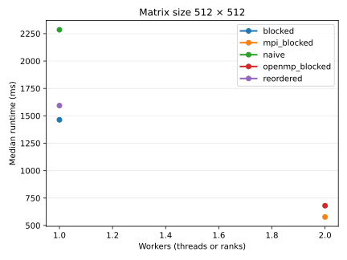
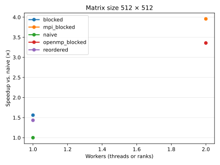

# Parallel Matrix Engine

A staged C++17 matrix-multiplication project. It includes naive, loop-reordered, cache-blocked, OpenMP-parallel, and MPI distributed-memory kernels for comparing memory-access patterns.

## Layout

```text
include/     Shared matrix, kernel, and timing interfaces
src/         Naive, reordered, blocked, OpenMP, and MPI kernels and drivers
```

## Build

Install a C++17 compiler, CMake, and an MPI implementation such as OpenMPI.

```bash
mkdir build
cd build
cmake ..
cmake --build .
```

These commands create `matrix_naive`, `matrix_reordered`, `matrix_blocked`, `matrix_openmp`, and `matrix_mpi` in the `build/` directory.

## Run

```bash
./matrix_naive
./matrix_reordered
./matrix_blocked
OMP_NUM_THREADS=4 ./matrix_openmp
```

All executables print machine-readable `key=value` output. The `result_sum` values must match; compare `time_ms` to measure the effect of each optimization. Set `OMP_NUM_THREADS` to test a chosen OpenMP thread count.

## Loop-order optimisation

`matrix_naive` uses `i-j-k`. With row-major storage, changing `k` in the inner loop reads `B[k][j]`: one element from each successive row of `B`. Those accesses are separated by an entire row, so most of each fetched cache line is not reused immediately.

`matrix_reordered` uses `i-k-j`. Its inner loop reads `B[k][j]` and writes `C[i][j]` while `j` increases, so both accesses move through contiguous elements in a row. A cache line fetched for `B[k][j]` or `C[i][j]` therefore supplies several upcoming iterations, improving spatial locality and cache-line utilisation without changing the mathematical result.

## Cache blocking and tiling

`matrix_blocked` keeps the cache-friendly `i-k-j` inner-loop order, but performs it within 32×32 tiles. The outer `ii`, `jj`, and `kk` loops restrict one phase of the calculation to a small tile of `A`, `B`, and `C`.

Compared with processing whole matrices at once, those smaller working sets are more likely to remain in cache while their values are reused. In particular, a tile of `C` is updated repeatedly across the matching `k` tiles before moving to the next output tile, reducing cache evictions and memory traffic. This can improve performance beyond loop reordering alone, although the best tile size depends on the CPU cache hierarchy. Boundary checks retain correctness when a matrix dimension is not divisible by 32.

## OpenMP parallelism

`matrix_openmp` parallelises independent output tiles with `#pragma omp parallel for collapse(2) schedule(static)`. Each thread owns a distinct `C` tile and processes every corresponding `k` tile itself, so no threads write the same output elements. Matrices `A` and `B` are shared read-only; the cache-blocked `i-k-j` computation remains local to each assigned output tile.

## MPI distributed-memory parallelism

`matrix_mpi` gives each MPI rank a contiguous block of rows from `A` using `MPI_Scatterv`; uneven row counts are handled when the matrix size is not evenly divisible by the rank count. It broadcasts the full read-only matrix `B` with `MPI_Bcast`, runs the existing blocked kernel on each rank's local rows, and reassembles `C` with `MPI_Gatherv`.

Each rank computes a local output sum, and `MPI_Allreduce` combines those values into the global `result_sum`. The reported duration is the slowest rank's elapsed time and includes the distribution, local computation, gather, and reduction phases. Verify that the global result sum matches the sequential baseline.

### Launch with a host file

`hosts.example` is a committed template. Copy it to `hosts`, then replace the host names and `slots` values with the machines and available MPI ranks in your environment. The local `hosts` file is ignored by Git because it is machine-specific.

From the `build/` directory, launch with:

```bash
mpiexec --hostfile ../hosts ./matrix_mpi
```

For example, a host file with two slots on each of two hosts launches four ranks by default. Add `-n N` when you need to run fewer ranks than the total listed slots.

## Benchmark data and graphs

Raw measurements are tracked in `data/benchmarks.csv`. Run each configuration 10 times; the plotting script uses the median of repeated runs. From the `build/` directory, run:

```bash
for run in $(seq 1 10); do ./matrix_naive | python3 ../scripts/record_benchmark.py; done
for run in $(seq 1 10); do ./matrix_reordered | python3 ../scripts/record_benchmark.py; done
for run in $(seq 1 10); do ./matrix_blocked | python3 ../scripts/record_benchmark.py; done
for run in $(seq 1 10); do OMP_NUM_THREADS=1 ./matrix_openmp | python3 ../scripts/record_benchmark.py; done
for run in $(seq 1 10); do OMP_NUM_THREADS=2 ./matrix_openmp | python3 ../scripts/record_benchmark.py; done
for run in $(seq 1 10); do OMP_NUM_THREADS=4 ./matrix_openmp | python3 ../scripts/record_benchmark.py; done
for run in $(seq 1 10); do mpiexec --hostfile ../hosts ./matrix_mpi | python3 ../scripts/record_benchmark.py; done
```

To collect 100 runs later, replace `seq 1 10` with `seq 1 100` in the relevant command.

After collecting the measurements, return to the repository root and generate the graphs:

```bash
    python3 scripts/plot_benchmarks.py
```

The plotting script requires Matplotlib (`sudo apt install python3-matplotlib` on Debian/Ubuntu), writes SVG graphs to `docs/plots/`, verifies that recorded result sums agree, and replaces the graph block below. Commit the CSV data, generated SVGs, and README update together.

<!-- benchmark-plots:start -->



<!-- benchmark-plots:end -->

### Recorded results

The current dataset contains 110 successful runs per implementation for 512 × 512 matrices. Sequential variants use one worker; OpenMP uses two threads; MPI uses two ranks. Every recorded checksum is `-198.146`, matching the naive baseline.

| Implementation | Configuration | Median runtime (ms) | Speedup vs. naive |
|---|---|---:|---:|
| Naive | 1 worker | 2285.159 | 1.000× |
| Loop reordered | 1 worker | 1593.818 | 1.434× |
| Cache blocked | 32 × 32 tiles, 1 worker | 1463.679 | 1.561× |
| OpenMP blocked | 32 × 32 tiles, 2 threads | 680.567 | 3.358× |
| MPI blocked | 32 × 32 tiles, 2 ranks on same node | 577.418 | 3.958× |

The loop-reordered kernel reduces median runtime by about 30% relative to the naive baseline; blocking increases that reduction to about 36%. The measured MPI median is about 18% lower than the two-thread OpenMP median in this setup. That comparison is configuration-specific: MPI ranks may be scheduled across different VMs, while OpenMP threads share one VM, so it does not establish that MPI is inherently faster than OpenMP on identical hardware.
